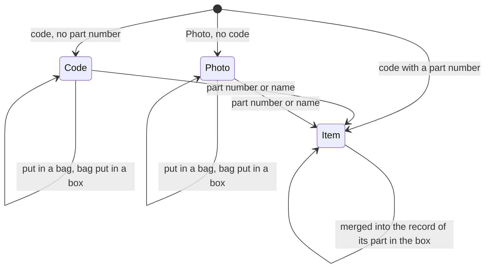

# Notes

- **Printing through tprint, not WebHID**: the printer protocol already lives in
  `~/thermal-printer/tprint.py` (USB HID and Bluetooth RFCOMM, LZMA blocks). A Python bridge
  imports that file and exposes `/api/printer` and `/api/print`; the browser renders the whole
  label itself at 8 dots per mm so the preview is the print. The bridge fits the PNG onto whatever
  label is loaded (shrink only, centered) and clamps the width to the 48 mm head like tprint does.
  Web Bluetooth cannot do RFCOMM and WebHID would mean porting the LZMA framing, so the bridge is
  the one thing that is not "in the browser".
- **Printer opened per job**: tprint's printer classes have no close method; the bridge closes the
  hidraw fd or the socket itself after each job, under a lock, so a stuck job cannot wedge the
  server and the status call always reflects the printer as it is now.
- **Same-origin printing**: the bridge serves the app, so no CORS is needed. A page from another
  origin can print only with `--cors-origin`; POSTs with a foreign `Origin` get 403, since a
  browser sends simple POSTs cross-origin without asking.
- **Port 8790**: 8787 was already taken by another local service here.
- **Decoding**: zxing-wasm (zxing-cpp) reads Data Matrix far better than the pure JS readers on
  photos of small bag codes. It runs in a Web Worker with the frame's pixel buffer transferred, at
  most ten frames a second, so the page stays responsive on a phone. The wasm file is copied into
  dist/ and located relative to the worker script, so the app works offline.
- **DigiKey codes**: ISO 15434 format "06" with MH10.8.2 data identifiers between GS characters.
  Older labels carry the DigiKey part number in `P`; newer ones put a customer part number in `P`
  and the DigiKey number in `30P`. zxing in its default HRI text mode spells the separators as
  `{GS}`; the worker asks for `Plain` text and the parser accepts both spellings.
- **Type guessing**: a short table of part number families gives a first guess; the type the user
  picks is remembered per family key (leading letters plus one digit, `RC0`, `STM3`, `1N4`) and
  wins over the table next time.
- **Auto capture**: one capture per bag. A code must be seen in two consecutive frames (settle),
  then the same code is ignored until the frame has shown no code for 1.5 s (release). A different
  code captures at once; the same bag removed and shown again captures again, which is right for
  two identical bags.

```mermaid
gantt
    title Auto capture over one bag swap
    dateFormat ss
    axisFormat %S s
    section Camera
    bag A in frame        :a1, 00, 4s
    empty                 :a2, after a1, 2s
    bag B in frame        :a3, after a2, 3s
    section Rule
    settling (2 frames)   :s1, 00, 1s
    held, A ignored       :h1, after s1, 3s
    release wait 1.5 s    :r1, after a1, 2s
    settling              :s2, after a2, 1s
    held, B ignored       :h2, after s2, 2s
    section Captures
    capture A             :milestone, c1, 01, 0s
    capture B             :milestone, c2, 07, 0s
```

- **Overlay geometry**: the video and the overlay canvas sit in the same box with
  `object-fit: contain`, and the canvas gets the decoded frame's intrinsic size, so code outlines
  land on the picture without any coordinate mapping.
- **Label text**: drawn with the canvas text API then thresholded to black and white. Thresholding
  keeps letters crisp; letting the printer dither anti-aliased gray gives speckled edges. The QR
  code is drawn module by module at a whole number of dots, with a two module quiet zone, the same
  rule as tprint. "qrsort:bag:7" fits a version 1 symbol.
- **Shelf order**: boxes carry a position, 1 at the left. Moving a box renumbers both shelves
  1..n in one transaction so there are never gaps or duplicates; the guidance is just the
  difference of two positions.
- **Store tests**: run on `fake-indexeddb` under bun, which is enough to cover the transactions.
- **Headless checks**: Firefox's `--screenshot` captures on the load event, before the app's
  asynchronous database open resolves, so it only shows the page background. Playwright's
  Chromium is used instead, with a Y4M clip as a fake camera (`--use-file-for-fake-video-capture`),
  which exercises the real camera, worker and capture path. Playwright's own downloader fails
  under bun with `ERR_TLS_CERT_ALTNAME_INVALID`; the zips from its `--dry-run` URLs unpacked into
  `~/.cache/ms-playwright/<name>/` with an `INSTALLATION_COMPLETE` marker work.
- **One record per part per box**: a part number may appear once per place, the place being the
  box when the bag is in one, else the bag, else the batch, else "loose". A save that finds an
  earlier record of the same part there (manufacturer PN, else vendor PN, case-insensitive) adds to
  it: bag quantity and current count are summed, blanks filled, the earlier record keeps its bag,
  number and photo. Every raw code merged in is remembered, so the same label scanned twice adds
  nothing ("already counted"); distinct labels of one order line still add. When the earlier record
  sits in another bag of the box, the user is told to put the bag there. Moving a whole bag into a
  box does not merge (the parts physically stay in their bags); "Merge duplicates" does, and also
  cleans up older data. The real export in test-data/ goes from 56 records to 41.
- **Bag quantity vs count**: `qty` is what the labels said (summed over merged bags), `count` the
  number on hand, starting equal. Older records get `count = qty` when read.
- **Item numbers**: items keep their UUID key; `seq` is the short id shown as `I-12`, from an "item"
  counter. Database version 2 numbers existing items in creation order inside the upgrade
  transaction; restoring a version 1 backup does the same after the highest number present.
- **Waiting to be identified**: two kinds, listed apart: a code that yields no part number (source
  "unknown", keyed by its raw text so a repeat does not duplicate it) and a photo of a bag with no
  code (source "photo", never merged, since every photo is a bag of its own). Both are saved outside
  any bag and batch. Placement is independent of the state: moving one to a bag, or its bag to a
  box, leaves it waiting (placing one by hand used to accept it as an item, filing a code's raw
  text as if it were a part). Only a part number or a name identifies it, and that rule sits in
  the store's `put`, so the draft, the item dialog and edit mode cannot disagree. A waiting record
  is not listed in its bag, only counted there ("2 to identify"); deleting the bag still deletes
  it, so the confirmation counts it too.
- **Photo with no code is a button**: without a code there is nothing to tell a bag in view from an
  empty table, so auto capture cannot take it. The photo is kept whether or not "Save photo" is on.
  A picture chosen with "Scan a photo" in which nothing reads becomes a draft to save or discard,
  not a record, since it may just be a bad shot.
- **Backups and photos**: backups leave photos out (as before), so a photo with no code comes back
  from a restore as an empty record. Identify those before relying on a backup.

- **1D barcodes**: only data-identifier fields count (1P, 30P, P, Q, 9D, 1T, 4L, K..., 1V), joined
  across the codes in one frame into an ISO 15434 message, and only when they name a part: 1P/30P,
  a P ending in -ND, or P with Q. Without that, a plain part number like "PIC16F84A" would read as
  P + "IC16F84A", and EAN/UPC product codes would flood the unidentified list. Auto capture keys a
  1D row by its part, so a frame that reads one more barcode of the label is still the same bag.
- **DigiKey customer references**: a DigiKey label without 30P whose P does not end in -ND carries
  the buyer's reference there ("U7", "PROTOCARD" in real data), not a DigiKey number; it goes to the
  notes, not the vendor PN.
- **Looking closer**: zxing is asked to return symbols it found but could not decode
  (`returnErrors`). Their bounds, widened 40%, are cut from the full-resolution video (the decoded
  frame is scaled to 1280 wide), enlarged to about 800 px and decoded again inverted, denoised and
  with the global histogram binarizer. After four frames like that, an ImageCapture still is taken
  (where the browser has it, at most every 2.5 s). The camera is asked for 1920x1080. Unread codes
  are outlined dashed orange.

```mermaid
gantt
    title A bag code that will not read at first (10 frames a second)
    dateFormat x
    axisFormat %L ms
    section Frame
    code found, not read        :f1, 0, 500ms
    read                        :f2, after f1, 100ms
    section Decoder
    frame at 1280 wide          :d1, 0, 600ms
    region at full resolution   :d2, 0, 500ms
    still (4th miss on)         :d3, 400, 100ms
    section Sign and LED
    cyan: code in view          :l1, 0, 500ms
    green: saved                :l2, after f1, 1500ms
```

- **Zoom**: the camera's own zoom when `getCapabilities().zoom` offers one, else a centered crop:
  frames, regions and photos are cut from the middle 1/zoom of the video, and the video element is
  CSS-scaled by the same factor about its center. The overlay canvas keeps the frame's size with
  `object-fit: contain`, so outlines still land on the code with no mapping.
- **Text reading**: tesseract.js (LSTM engine, English "best_int" data) runs in its own worker,
  loaded on first use from dist/ocr/ (worker, three core builds picked by SIMD support, 3 MB of
  language data), so it works offline and costs nothing until switched on. With code splitting,
  Bun hands a dynamically imported CommonJS package over as its default export only, so the named
  `createWorker` was undefined until taken from `default`. A read's confidence is the lowest line
  confidence among the lines the fields came from; below the threshold an automatic read is
  dropped and a manual one opens for checking. A read is ignored if a code turned up meanwhile.
  `NOMINIFY=1 bun run build.ts` keeps names readable when a bundle error needs a stack.
- **Auto capture across restarts**: the "held" code survived stopping the camera, so after
  switching bags the same bag never captured again. Starting the camera and changing the bag or
  batch now reset it.
- **Status LED host side**: the app polls `GET /api/led` at most every 10 s until something is
  attached and sends one color at a time, always ending on the newest, since threaded replies can
  arrive out of order.
- **Status LED firmware**: on embassy-rp 0.10 the endpoint read never fails on unplug, so the host
  leaving is taken from embassy-usb `Handler` callbacks (reset, suspend, deconfigured, disabled)
  raised through a `Signal`; DTR falling (port closed) also turns the LED off, so
  `echo '#ff0000' > /dev/ttyACM0` lights it only for an instant (keep the port open, or
  `stty -F /dev/ttyACM0 -hupcl`). Gamma 2 without floats: PWM TOP = 255*255-1 and compare =
  level squared, 255 being always on. Replies are batched under 64 bytes so no zero-length packet
  is needed, and dropped after 100 ms when nobody reads them. The bridge flushes input and sends a
  bare newline on open to clear any partial line. The protocol is a dependency-free lib so
  `fw-test` runs it on the host; `.cargo/config.toml` stays inside firmware/ because its
  `build.target` applies to every crate below it.
