# Notes

- **Printing through tprint, not WebHID**: the printer protocol already lives in
  `~/thermal-printer/tprint.py` (USB HID and Bluetooth RFCOMM, LZMA blocks). A Python bridge
  imports that file and exposes `/api/printer` and `/api/print`; the browser renders the whole
  label itself at 8 dots per mm so the preview is the print. The bridge fits the PNG onto whatever
  label is loaded (shrink only, centered) and clamps the width to the 48 mm head like tprint does.
  Web Bluetooth cannot do RFCOMM and WebHID would mean porting the LZMA framing, so the bridge is
  the one thing that is not "in the browser".
- **Printer opened per job**: tprint's printer classes have no close method; the bridge closes the
  hidraw fd or the socket itself after each job, under a lock, so a stuck job cannot wedge the
  server and the status call always reflects the printer as it is now.
- **Same-origin printing**: the bridge serves the app, so no CORS is needed. A page from another
  origin can print only with `--cors-origin`; POSTs with a foreign `Origin` get 403, since a
  browser sends simple POSTs cross-origin without asking.
- **Port 8790**: 8787 was already taken by another local service here.
- **Decoding**: zxing-wasm (zxing-cpp) reads Data Matrix far better than the pure JS readers on
  photos of small bag codes. It runs in a Web Worker with the frame's pixel buffer transferred, at
  most ten frames a second, so the page stays responsive on a phone. The wasm file is copied into
  dist/ and located relative to the worker script, so the app works offline.
- **DigiKey codes**: ISO 15434 format "06" with MH10.8.2 data identifiers between GS characters.
  Older labels carry the DigiKey part number in `P`; newer ones put a customer part number in `P`
  and the DigiKey number in `30P`. zxing in its default HRI text mode spells the separators as
  `{GS}`; the worker asks for `Plain` text and the parser accepts both spellings.
- **Type guessing**: a short table of part number families gives a first guess; the type the user
  picks is remembered per family key (leading letters plus one digit, `RC0`, `STM3`, `1N4`) and
  wins over the table next time.
- **Auto capture**: one capture per bag. A code must be seen in two consecutive frames (settle),
  then the same code is ignored until the frame has shown no code for 1.5 s (release). A different
  code captures at once; the same bag removed and shown again captures again, which is right for
  two identical bags.

```mermaid
gantt
    title Auto capture over one bag swap
    dateFormat ss
    axisFormat %S s
    section Camera
    bag A in frame        :a1, 00, 4s
    empty                 :a2, after a1, 2s
    bag B in frame        :a3, after a2, 3s
    section Rule
    settling (2 frames)   :s1, 00, 1s
    held, A ignored       :h1, after s1, 3s
    release wait 1.5 s    :r1, after a1, 2s
    settling              :s2, after a2, 1s
    held, B ignored       :h2, after s2, 2s
    section Captures
    capture A             :milestone, c1, 01, 0s
    capture B             :milestone, c2, 07, 0s
```

- **Overlay geometry**: the video and the overlay canvas sit in the same box with
  `object-fit: contain`, and the canvas gets the decoded frame's intrinsic size, so code outlines
  land on the picture without any coordinate mapping.
- **Label text**: drawn with the canvas text API then thresholded to black and white. Thresholding
  keeps letters crisp; letting the printer dither anti-aliased gray gives speckled edges. The QR
  code is drawn module by module at a whole number of dots, with a two module quiet zone, the same
  rule as tprint. "qrsort:bag:7" fits a version 1 symbol.
- **Shelf order**: boxes carry a position, 1 at the left. Moving a box renumbers both shelves
  1..n in one transaction so there are never gaps or duplicates; the guidance is just the
  difference of two positions.
- **Store tests**: run on `fake-indexeddb` under bun, which is enough to cover the transactions.
- **Headless checks**: Firefox's `--screenshot` captures on the load event, before the app's
  asynchronous database open resolves, so it only shows the page background. Playwright's
  Chromium is used instead, with a Y4M clip as a fake camera (`--use-file-for-fake-video-capture`),
  which exercises the real camera, worker and capture path. Playwright's own downloader fails
  under bun with `ERR_TLS_CERT_ALTNAME_INVALID`; the zips from its `--dry-run` URLs unpacked into
  `~/.cache/ms-playwright/<name>/` with an `INSTALLATION_COMPLETE` marker work.
