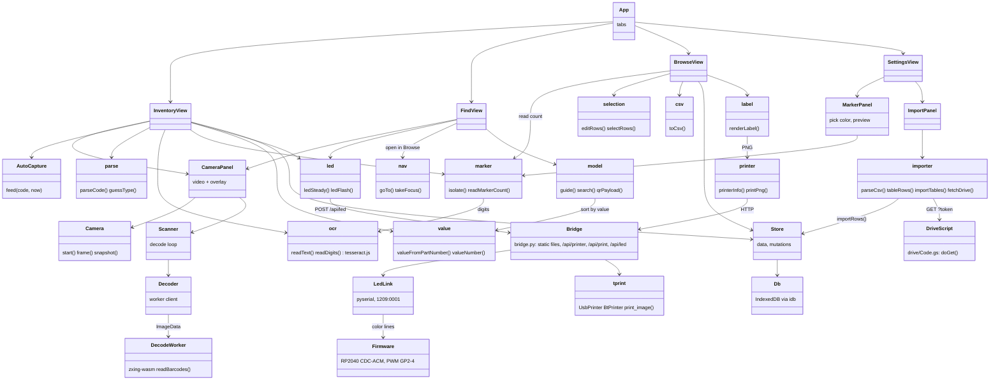

# qr-sort

Sorts parts into bags, bags into boxes, boxes onto shelves, and finds them again. Runs in the
browser: the camera reads the Data Matrix on DigiKey bags (Mouser and LCSC codes, rows of 1D
barcodes, and as a fallback the label's printed text), items are
stored in the browser's own database with an optional photo, and bags and boxes get QR labels from
the Supvan thermal printer through [tprint](../thermal-printer). To retrieve something, the camera
reads the box labels on the shelf and points left or right until the right box is in view.

## Setup

```sh
mise run install          # bun install
mise run build            # bundles the app into dist/
mise run serve            # http://localhost:8790/ with the printer over USB
mise run serve-bt         # the same, printer over Bluetooth
mise run cert && mise run serve-tls   # HTTPS on the LAN so a phone's camera works
mise run fw-flash         # optional status LED: flash the RP2040 held in BOOTSEL mode
```

The bridge (`bridge.py`) serves `dist/` and prints through `~/thermal-printer/tprint.py`
(`--tprint` or `TPRINT` to point elsewhere). The app itself needs only a static server; without
the bridge, labels download as PNG files for `tprint.py -i`. Cameras only work on `localhost` or
HTTPS, hence `serve-tls` for phones.

## Use

- **Inventory**: pick or make the bag being filled, start the camera, hold each bag in view. With
  auto scan on, a bag is captured once it has settled in the frame and the next one only after it
  has been taken away. Auto save stores it at once; otherwise the parsed fields appear for checking.
  A big sign over the picture says what happened: green saved, orange "already counted", magenta
  saved unidentified with a code, violet saved unidentified with no code. Scanning a bag label
  switches to that bag, scanning a box label puts the current bag in that box. "Retake last" takes
  the photo of the bag saved last again. "Add by hand" is for a bag with no code that reads: take
  its photo there and fill in what is known. "Scan a photo" reads a picture instead of the camera
  (opening "Add by hand" with it when nothing in it reads); the slider zooms.
- **One record per bag**: every bag scanned is a record of its own, even for a part already in the
  box; the same label scanned twice in a box is counted once. Items show a short id (`I-12`) and
  their value (`10k`, `100nF`), read from common resistor and capacitor part numbers and editable.
- **Batch mode**: scans collect in a batch (date, time, random code) instead of a bag; "Put batch in
  bag" files them, "Clear batch" drops the batch and keeps the items.
- **Unidentified**: a code without a part number, or a bag added with only a photo, is saved where
  it was scanned like any other, flagged unidentified. Moving it, or its bag, keeps the flag; a part
  number or a name clears it. Browse also lists them all, codes and photos apart.
- **Marker count**: write the current count on a bag with a colored marker. In Settings, click the
  writing in a picture to pick the color and tune the sliders until the second picture shows only
  the writing; with "Read marker count" on, each saved bag's count is read from its photo.
- **Read text**: with no code in view for a while, the label's printed text is read; reads below the
  confidence set in Settings are not used.
- **Find**: search by part number, name, type, bag or box. Pick a result, point the camera at the
  shelf: an arrow says how many boxes left or right, a check mark means this box (or this bag).
  Without a target, pointing at a label lists what is in it.
- **Browse**: shelves, boxes (numbered left to right) and bags as a tree; edit names and places,
  print labels, open items. Items sort as scanned or by type then value, in each bag and in a box's
  "All parts" list. "Not placed" collects anything without a home. Edit mode selects with click and
  shift-click and moves items to a bag, bags to a box, boxes to a shelf. Export CSV.
- **Import**: in Settings, every CSV file and Google Sheet in a Drive folder (through the Drive
  script below), or one CSV file. Columns are matched by heading: qr-sort's own CSV and distributor
  order exports; other columns go in the notes. Rows go in the bag, box and shelf they name
  ("Bag 3", "Bag 3: Resistors" or a name), made when missing, else in a bag named after their file.
  Importing again adds only new rows.
- **Settings**: the toggles, text confidence, the marker color, the status LED, the bridge URL and
  label size, the camera, imports, backups, CSV.

## Import from Google Drive

`drive/Code.gs` is an Apps Script web app that answers with the cells of every CSV file and Google
Sheet in one Drive folder (shared drives too). Setup, also written at the top of the script:

1. At script.google.com, a new project: `drive/Code.gs` as Code.gs, `drive/appsscript.json` as the
   manifest (Project Settings > "Show appsscript.json in editor").
2. Script properties: `FOLDER_ID`, the last part of the folder's URL; `RECURSIVE` = `true` for
   subfolders.
3. Run `makeToken` once (grants read-only access, logs the token); `checkFolder` shows what is read.
4. Deploy > Web app, execute as Me, access Anyone. Settings > Import takes the `/exec` URL and the
   token; `mise run drive-check <url> <token>` asks the same from a terminal.

The token is the only guard on the folder. Workspace domains that forbid "Anyone" deployments cannot
serve it this way.

## Status LED (optional)

A Raspberry Pi Pico with an RGB LED on GP2 (red), GP3 (green), GP4 (blue), a resistor per color and
the common cathode to GND (common anode: to 3V3, and `ACTIVE_LOW = true` in
`firmware/src/main.rs`). Hold BOOTSEL while plugging it in, then `mise run fw-flash`. It shows dim
white for 200 ms at power-up. The bridge finds it by USB id 1209:0001 (`--led /dev/ttyACM0` to name
a port, `--no-led` to skip it; the user needs the `dialout` group). Without it nothing changes.

## Architecture



## Tests

```sh
mise run test     # bun unit tests (parser, values, marker, model, auto capture, labels, store, decoder, CSV,
                  # import, the Drive script on stand-in services) + pytest for the bridge
mise run e2e      # the built app in Chromium with a fake camera showing bag codes
mise run fw-test  # the LED firmware's line protocol, on this machine
```
