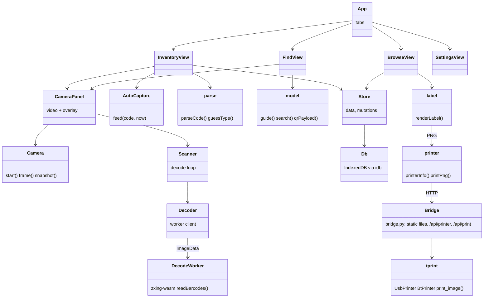

# qr-sort

Sorts parts into bags, bags into boxes, boxes onto shelves, and finds them again. Runs in the
browser: the camera reads the Data Matrix on DigiKey bags (Mouser and LCSC codes too), items are
stored in the browser's own database with an optional photo, and bags and boxes get QR labels from
the Supvan thermal printer through [tprint](../thermal-printer). To retrieve something, the camera
reads the box labels on the shelf and points left or right until the right box is in view.

## Setup

```sh
mise run install          # bun install
mise run build            # bundles the app into dist/
mise run serve            # http://localhost:8790/ with the printer over USB
mise run serve-bt         # the same, printer over Bluetooth
mise run cert && mise run serve-tls   # HTTPS on the LAN so a phone's camera works
```

The bridge (`bridge.py`) serves `dist/` and prints through `~/thermal-printer/tprint.py`
(`--tprint` or `TPRINT` to point elsewhere). The app itself needs only a static server; without
the bridge, labels download as PNG files for `tprint.py -i`. Cameras only work on `localhost` or
HTTPS, hence `serve-tls` for phones.

## Use

- **Inventory**: pick or make the bag being filled, start the camera, hold each bag in view. With
  auto scan on, a bag is captured once it has settled in the frame and the next one only after it
  has been taken away. Auto save stores it at once; otherwise the parsed fields appear for checking.
  Scanning a bag label switches to that bag, scanning a box label puts the current bag in that box.
  "Scan a photo" reads a picture instead of the camera, "Add by hand" skips the code.
- **Find**: search by part number, name, type, bag or box. Pick a result, point the camera at the
  shelf: an arrow says how many boxes left or right, a check mark means this box (or this bag).
  Without a target, pointing at a label lists what is in it.
- **Browse**: shelves, boxes (numbered left to right) and bags as a tree; edit names and places,
  print labels, open items. "Not placed" collects anything without a home.
- **Settings**: the toggles, the bridge URL and label size, the camera, backups.

## Architecture



## Tests

```sh
mise run test     # bun unit tests (parser, model, auto capture, labels, store, decoder) + pytest for the bridge
mise run e2e      # the built app in Chromium with a fake camera showing bag codes
```
